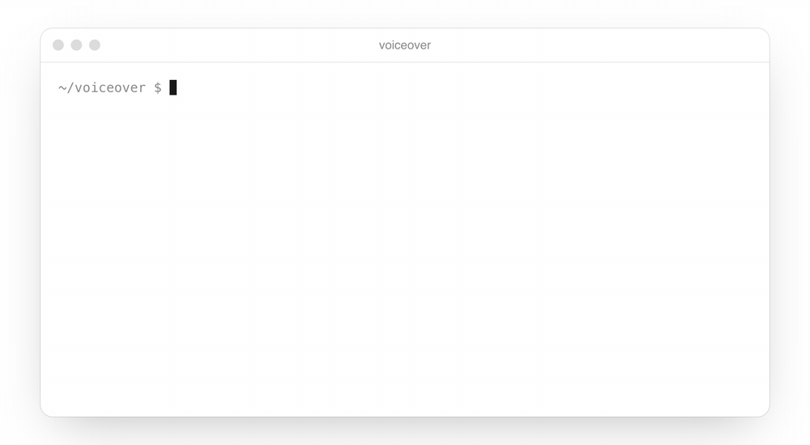

<p align="center">
  <picture>
    <source media="(prefers-color-scheme: dark)" srcset="docs/assets/wordmark-white.svg">
    
  </picture>
</p>

<h3 align="center">Let AI use your keys without seeing them</h3>

<p align="center">Don’t let AI expose your secrets.<br />Get set up in seconds and forget about it.</p>

<p align="center"></p>

<p align="center"><a href="https://ephibbs.github.io/keydillo-site/">Website</a> · <a href="#install">Install</a> · <a href="SECURITY.md">Security</a> · <a href="docs/roadmap.md">Roadmap</a></p>

keydillo is a free, open-source Mac menu-bar app. Your API keys stay in the Keychain, behind Touch ID. Claude Code and your programs only get placeholders, and keydillo adds the real key on the way out, only to that key's host.

No account, no cloud, no telemetry. MIT licensed.

## How it works

1. Install keydillo and connect Claude.
2. Import your `.env`. Keys become placeholders.
3. Ask Claude to run it. It adds `kd`.
4. Approve with Touch ID.
5. The real API key goes out. Claude never sees it.

The rule: **put `kd` in front. Claude does it for you.**

```sh
kd npm run dev
```

## What keydillo protects against, and what it doesn't

| | Situation | Notes |
|---|---|---|
| ✅ | An AI agent reads your `.env` | It finds `keydillo:<name>` placeholders, not keys. |
| ✅ | A key gets committed to GitHub | Only the placeholder is in the file. |
| ✅ | A key ends up in a chat, transcript or log | Agents never get the value, and keydillo scrubs it from responses. |
| ✅ | Other apps reading your Keychain | Keys sit in a private Keychain group only keydillo's signed app can open, behind Touch ID. |
| ✅ | A key sent to the wrong site | Each key goes only to its own host. A new host needs your Touch ID. |
| ✅ | Web pages calling the local proxy | Cross-site browser requests are refused. |
| ⚠️ | Someone who knows your login password | macOS lets it stand in for Touch ID. |
| ⚠️ | A program reusing an approval | With "Once per session", it can *use* the key without a new prompt, but still can't *read* it. |
| ⚠️ | Launch-time keys (database URLs, JWT secrets) | The program you start gets the real value, so it can read it. A database proxy is on the [roadmap](docs/roadmap.md). |
| ⚠️ | "Ask once per project" | Any program you run in that folder can use its keys without a prompt. Use it for low-cost keys. |
| ❌ | A program you approved misusing the key | keydillo guards the key, not what's done with it at the provider. |
| ❌ | Keys in deployed frontend code | keydillo works on your Mac, not in production. |
| ❌ | Copies made before you installed it | Old `.env` files, shell and git history. Rotate those keys. |
| ❌ | Go, Rust, gRPC, edge middleware under `kd` | They ignore kd's certificate. Call the key's local base URL instead. More in [docs/kd-known-failures.md](docs/kd-known-failures.md). |

Details are in [Security model and limits](#security-model-and-limits).

## Install

```sh
brew install --cask ephibbs/keydillo/keydillo
```

Then open keydillo and choose **Connect** in its setup. That sets up Claude Code: its tools, the skill, and the check that puts `kd` in front of commands.

Or [download the zip](https://github.com/Ephibbs/keydillo/releases/latest) (signed and notarized, macOS 15+), unzip it and move keydillo to Applications.

**Claude Code plugin** (instead of Connect):

```
/plugin marketplace add Ephibbs/keydillo
/plugin install keydillo@keydillo
```

**Skill only**, for other coding agents: `npx skills add Ephibbs/keydillo`. This adds the instructions but not the check before commands, so prefer Connect or the plugin for Claude Code.

**Build from source** (macOS 15+, Xcode 16, [XcodeGen](https://github.com/yonaskolb/XcodeGen), an Apple Developer account):

```sh
git clone https://github.com/Ephibbs/keydillo
cd keydillo/App
# set DEVELOPMENT_TEAM in project.yml to your team ID
xcodegen
open Keydillo.xcodeproj
```

Keys are stored in a private Keychain group tied to your team, so the Mac you build on must be registered in your developer account. Builds without that group refuse to store keys.

---

## Using your keys

**Put `kd` in front of commands that use your keys. Claude does it for you.**

- `kd npm run dev` (short for `keydillo run -- npm run dev`) runs the command with its HTTPS going through a
  small proxy that only that command and its child processes can use. When a program sends a
  `keydillo:<name>` placeholder to its API, keydillo asks for Touch ID and swaps in the real key. Everything
  else passes through untouched, still encrypted. `kd` is installed in `~/.local/bin`, next to `claude`.
- Claude Code (with the keydillo plugin, or after "Connect" in keydillo) is told to put `kd` in front of
  commands that call APIs. Nothing is routed without `kd`.
- If keydillo isn't running, `kd` opens it in the background (unless you quit it yourself from the menu).
- To stop using keydillo for a project or everything, use **Put my real keys back** (menu bar or Settings). Each import also saves a copy of the original .env files in keydillo's private Keychain group, as a safety net.
- If an API still says the key is invalid, the program skipped keydillo (see the limits below). Claude is told
  this right after the command; the fix is to call the API through its `*_BASE_URL`
  (`http://localhost:7787/<name>/...`).

Tested with curl, Python (`requests`, `httpx`, `aiohttp`, `urllib`), Node (`fetch`, `https`, `undici`, axios),
Bun and Deno. Results: `tests/compat/REPORT.md`.

## Credits

Service logos are from [Simple Icons](https://simpleicons.org) (CC0-1.0). Logos are trademarks of their owners and are used only to identify each service.

## Privacy

keydillo has **no telemetry**: no analytics, no crash reporting, no update pings. Nothing leaves your Mac except the
API requests you approve, sent straight to the provider you configured.

## Security model and limits

keydillo is responsible for keys **while it's installed**. Copies that existed before you installed it (old
`.env` files, shell history, git history, provider dashboards, chat transcripts) and copies you make yourself
afterwards (the Readout, Show key) are outside what it can protect.

Details:
- **Keychain:** keys live in a private access group only keydillo's signed binary can use, and reading one needs Touch ID. `security find-generic-password` and other apps can't see them.
- **Proxy:** agents get local addresses and placeholders. The proxy adds the key on the way out, only to that key's host. Requests with a non-localhost Host header or from another site are refused.
- **Approvals:** parallel calls from one program within 3 seconds of an approval share it.
- **Scrubbing** is best effort: it removes the forms of the key keydillo produced (raw, Basic, base64, percent-encoded), not ones a provider transforms other ways. That's why each key goes only in its one configured spot unless you turn on "Allow the key anywhere". Without it, a key the API wants in the body, query or path is refused with `placeholder_misplaced`.
- **Locked Mac:** keys can't be read, and requests get a "Mac is locked" reply. "Ask once per project" keys stay in keydillo's memory (locked into RAM, zeroed when dropped) after one Touch ID, and keep working until keydillo quits.
- **Launch-time keys** cover secrets your app uses itself (database URLs, JWT, session, encryption and webhook signing keys, AWS/Cloudinary signing keys, service-account files). The `.env` keeps a random placeholder, and `kd` hands over the real value at start after a Touch ID that names the command, every time. They're unticked at import.
- **Not under `kd` yet:** programs started with a cleaned environment, Python with `-I`, Docker with `--env-file` (use `http://host.docker.internal:7787/<name>`), and SDKs that check a key's format at startup, like Clerk.
- **The Claude Code hook** steers agents to keydillo. It isn't a security barrier.
- **Builds** without the private Keychain group refuse to store keys.

Report vulnerabilities privately: see [SECURITY.md](SECURITY.md).

## License

MIT. See [LICENSE](LICENSE).

keydillo is not affiliated with Anthropic.
