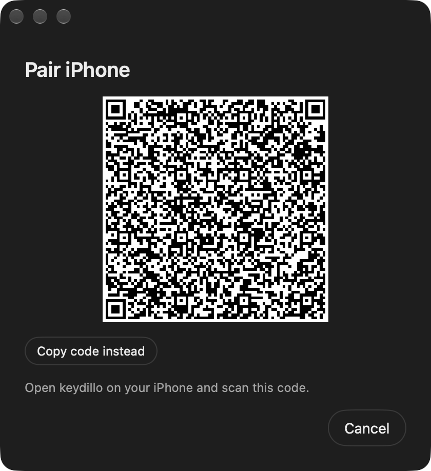
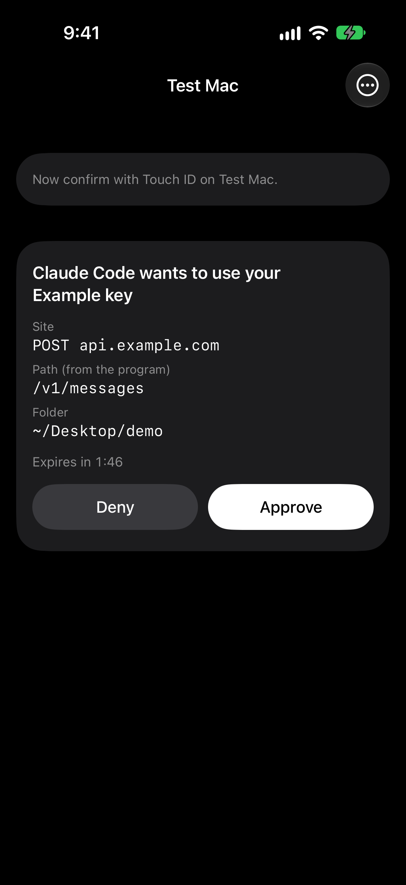

# iPhone approvals (prototype)

Branch `phone-approvals` in `~/Desktop/keydillo-phone` (a separate clone of keydillo, on top of 0.1.4). Not pushed, not released.

Approve keydillo requests from a paired iPhone with Face ID. The Mac shows Touch ID at the same time; whichever answers first wins. While the Mac is locked, the phone is the only way to answer.

 

## The wall, and the change to the plan

keydillo's keys carry `.userPresence` in the Keychain, so even keydillo can't read one without a Touch ID (or password) **on the Mac**. A signed "yes" from the phone can't produce that. The options were:

1. Store a second copy without Touch ID protection and trust the phone's signature. Weaker than today at rest.
2. **(Built)** Store a second copy that only the phone can unlock. Each key is encrypted with a random data key, and the data key is sealed to the phone's Secure Enclave key. Approving on the phone unseals the data key inside the Secure Enclave (after Face ID) and seals it again to a one-time key that exists only in the Mac's memory for that request. The phone sees the request details and the data key, never the key's value. Without the phone and a Face ID, the copy is as unreadable as the original.

Everything else follows the intended design: QR pairing, Secure Enclave keys, CloudKit private database as transport, signatures bound to request ID and expiry, first answer wins, prompt text from keydillo's own data.

## How it works

| Step | What happens |
|---|---|
| Pair | Mac shows a QR: Mac ID, Mac signing public key, a one-time pairing secret, 10-minute expiry. Phone creates two Secure Enclave keys (sign + key agreement, `.biometryCurrentSet`), replies through iCloud with its public keys, an HMAC with the pairing secret and a signature. Mac checks it and the user confirms with Touch ID, which also creates the phone copy of every key. |
| Ask | Mac writes a `KDAsk` record signed with its key: title, key name, bound host, method, path (labelled "from the program"), caller as keydillo identified it, folder, a one-time response key, the key's sealed data key. 2-minute expiry. |
| Notify | CloudKit query subscription pushes "Claude Code wants to use your OpenAI key" to the phone. |
| Answer | Phone verifies the Mac's signature and expiry, asks for Face ID, signs `{requestID, decision, digest of the ask, released data key}`. |
| Accept | Mac checks: paired phone's signature, same request ID, same ask digest, Mac's clock before expiry, first answer only. Then unwraps the key. Bad answers are ignored, not treated as denials. |
| Clean up | Mac deletes the ask and answer records. |

Code: `Packages/PhoneLink` (shared protocol, 17 tests), `App/Sources/PhoneApproval.swift` (Mac), `Phone/` (iPhone app, XcodeGen).

## Tested tonight (no Apple account steps, no devices)

- `cd Packages/PhoneLink && swift test`: 17 tests, all pass. Pairing, tampered/forged/expired asks, replay, answer moved to another request, answer for changed details, other phone, release sealed to one request only, race (phone wins and cancels Touch ID, Mac wins, forged answer ignored, timeout, phone timeout doesn't override an open Touch ID).
- Mac app builds; the real Pair iPhone window paired with a pretend phone (`kd-fakephone`) over a folder: QR decoded from a screenshot, reply verified, confirm screen shown. Touch ID step not pressed.
- iPhone app builds for simulator and for device (unsigned). In the simulator, over a folder: it paired with a pretend Mac (`kd-fakemac`), showed the request, approved it, and the pretend Mac got the dummy key value back.

## Not tested (needs Evan)

CloudKit, push notifications, Secure Enclave and Face ID, the Mac's real approval path with a real key, and anything while the Mac is locked.

## Morning test guide (about 30 minutes)

**Steps that need your Apple account (I can't do these):**
1. In Xcode, signed in as team 2JARAJYAYY, let it create the iCloud container `iCloud.com.studiokillswitch.keydillo` (happens the first time you build either app below with automatic signing). Containers can't be deleted, so if you want a different name, change it in `PhoneLink/CloudKitTransport.swift`, `App/project.icloud.yml` and `Phone/project.yml` first.
2. The iPhone app's bundle ID is `com.studiokillswitch.keydillo.phone`. Change it in `Phone/project.yml` before the first build if you prefer another.

**Mac:**
```bash
cd ~/Desktop/keydillo-phone/App && xcodegen --spec project.icloud.yml && open Keydillo.xcodeproj
```
Build and run the Keydillo scheme (Debug) from Xcode. Quit the installed keydillo first (`launchctl bootout gui/$(id -u)/com.studiokillswitch.keydillo.agent`), since both use the same port and Keychain group. Afterwards, quit the test build and open /Applications/keydillo.app; if it doesn't stay running, switch "Keep keydillo running" off and on in its Settings. (Not tried tonight.)

**iPhone:**
```bash
cd ~/Desktop/keydillo-phone/Phone && xcodegen && open KeydilloPhone.xcodeproj
```
Pick your iPhone as the destination, run. Allow notifications.

**Try:**
1. Mac: keydillo Settings → iPhone → Pair iPhone. Phone: Scan pairing code (Face ID). Mac: Pair with Touch ID. Settings should say "N keys ready".
2. With the Mac unlocked, run something through `kd` that uses a key. Touch ID shows on the Mac and a notification arrives on the phone. Approve on the phone: the Mac's Touch ID sheet should close and the request go through.
3. Same again, approve on the Mac instead: the phone's card should disappear within a few seconds.
4. Deny on the phone: the program gets "the user declined".
5. Lock the Mac (keep a `kd` loop running from ssh or a scheduled job), trigger a request, approve on the phone.
6. Unpair from Settings; requests should go back to Touch ID only.

**If something fails:** Console.app, filter "keydillo: phone link". CloudKit errors in development usually mean the schema hasn't been created yet; the phone creates it when it pairs.

## Known gaps (prototype)

1. Only per-request key use goes to the phone. New-host approvals, launch-time keys and "open project" prompts are still Mac-only.
2. A phone-released value is held in memory for the key's approval window (15 s for every-time keys, 30 min for once-per-session, or the window length). After that the next read needs the Mac or another phone approval.
3. Keys imported after pairing get a phone copy the first time they're approved on the Mac (or saved in the key window). Until then they're Mac-only.
4. The phone copies use "after first unlock" Keychain access so they can be read while the Mac is locked. Not yet checked on a locked Mac.
5. Deny also needs Face ID (one key signs both answers).
6. The Mac polls CloudKit every 1.5 s while a request is waiting, no Mac push yet.
7. Release builds: Developer ID with iCloud needs a Developer ID provisioning profile; `scripts/release.sh` is unchanged. The iPhone app would ship through TestFlight/App Store. CloudKit schema must be deployed to Production in the CloudKit console before any release.
8. Design wasn't mocked first; the screens are plain SwiftUI in the monochrome style.
9. Pairing code expires after 10 minutes; one phone per Mac.

## Estimate to ship (Claude build hours)

About 4 to 6 hours after the device test: fix what the test finds (1–2), the gaps above that matter (new-host and project prompts on the phone, Mac push, 2), release signing with iCloud (1), App Store listing, privacy labels and review notes (1). Tonight's prototype took about 2.5 hours.
